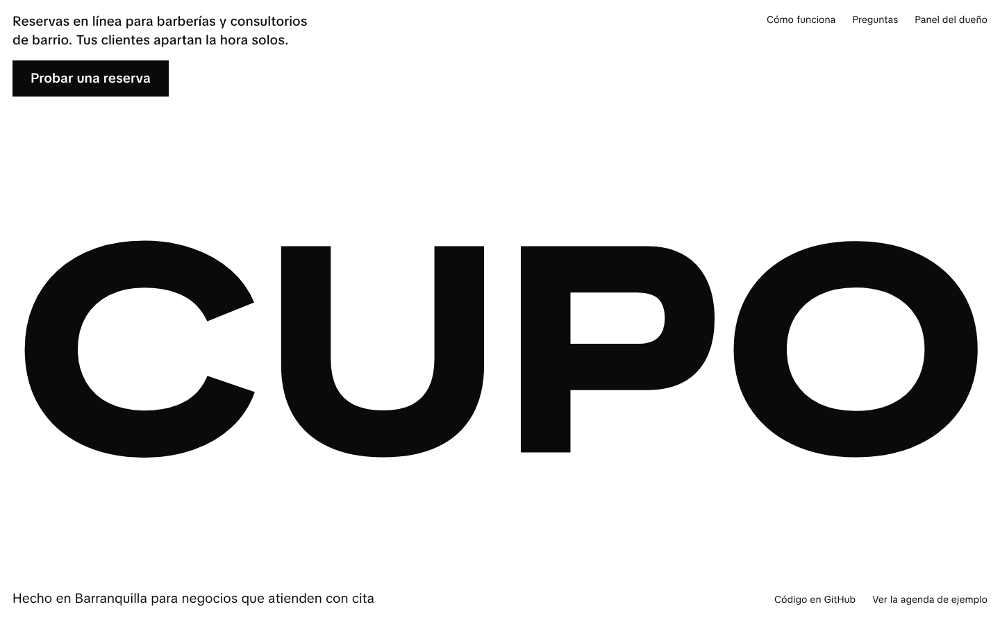
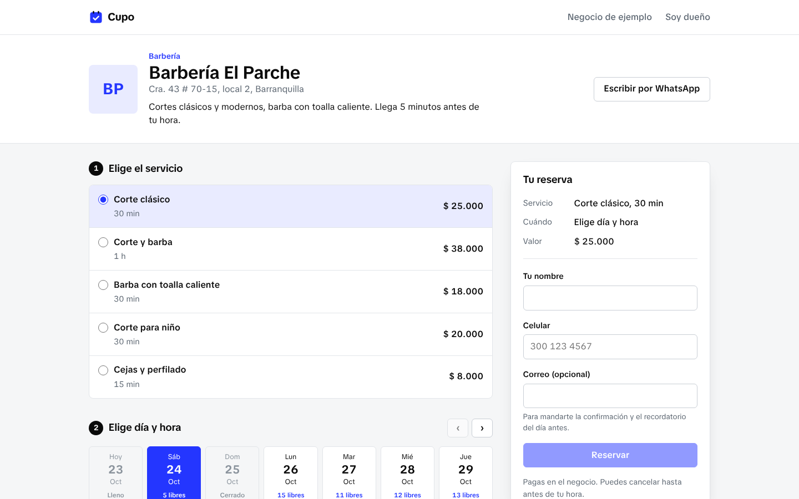
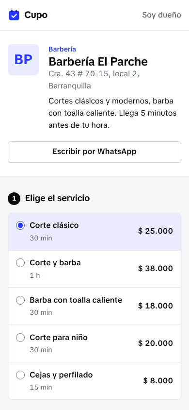
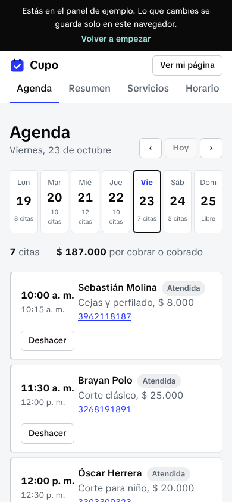
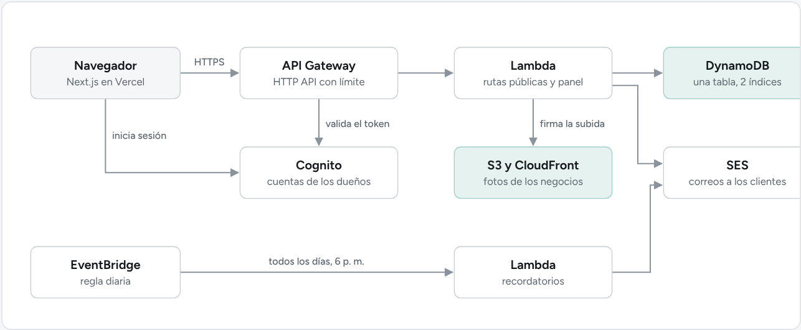

# Cupo

Reservas en línea para negocios que trabajan con citas: barberías, consultorios, canchas, spas. El negocio pone sus servicios y su horario, comparte un enlace, y sus clientes reservan solos sin crear cuenta. El dueño ve la agenda del día, marca quién llegó y al final de la semana ve cuánto entró.

El frontend está en Next.js y el backend corre en AWS sin servidores: Lambda, API Gateway, DynamoDB, Cognito, S3 y CloudFront, todo definido con CDK.





| Reservar desde el celular | Agenda del dueño |
| --- | --- |
|  |  |

## Qué hace

**Para el cliente**
- Elige servicio, día y hora. Solo ve las horas en las que la cita entera cabe antes de que el negocio cierre o empiece otra cita.
- Recibe un código de 6 letras para ver o cancelar su reserva sin cuenta, y un archivo para guardarla en el calendario del celular.
- Si dejó su correo, le llega la confirmación y un recordatorio a las 6 p. m. del día antes.

**Para el dueño**
- Agenda por semana, con las citas de cada día y botones para marcar atendida, no vino o cancelar.
- Servicios con duración y precio, horario por día con varias franjas (por ejemplo, cerrar al almuerzo) y días festivos o de vacaciones.
- Reglas de la agenda: cada cuánto empiezan los cupos, hasta cuántos días antes se puede reservar y con cuánto aviso mínimo.
- Resumen de los últimos 7 días: citas, lo cobrado, qué porcentaje del tiempo abierto estuvo ocupado y cuánta gente no llegó.
- Foto del negocio, que se sube directo a S3 con una URL firmada.

## Arquitectura



```
packages/core   lógica de cupos y reservas, sin dependencias de AWS ni de React
api             las tres Lambdas y el repositorio sobre DynamoDB
infra           el stack de CDK
web             la app en Next.js
```

La lógica vive en `packages/core` y la usan tanto las Lambdas como el navegador. Así, el modo de ejemplo del sitio corre exactamente las mismas reglas que producción, solo que guardando en `localStorage` en vez de DynamoDB.

### Cómo se evitan las reservas dobles

Dos personas pueden ver libre las 10:00 al mismo tiempo. Revisar antes de guardar no alcanza, porque entre la revisión y la escritura puede entrar la otra.

Cada cita ocupa bloques de 15 minutos, y cada bloque es un ítem en DynamoDB (`OCUPA#2026-10-26#10:00`). La reserva y todos sus bloques se escriben en una sola `TransactWriteItems` con `attribute_not_exists(PK)` en cada bloque. Si otra reserva tomó cualquiera de esos bloques un instante antes, DynamoDB cancela la transacción completa y la API responde 409; la página recarga los cupos y le pide al cliente que elija otra hora. Al cancelar, los bloques se borran en la misma transacción que cambia el estado.

### Una sola tabla

| PK | SK | Qué es |
| --- | --- | --- |
| `NEG#<id>` | `PERFIL` | el negocio |
| `NEG#<id>` | `SERV#<id>` | un servicio |
| `NEG#<id>` | `HORARIO` | el horario de la semana |
| `NEG#<id>` | `RES#<fecha>#<hora>#<id>` | una reserva |
| `NEG#<id>` | `OCUPA#<fecha>#<hora>` | un bloque de 15 minutos tomado |
| `SLUG#<slug>` | `SLUG` | la dirección del negocio, para que no se repita |
| `DUENO#<sub>` | `NEGOCIO` | qué negocio administra cada usuario de Cognito |

La agenda de una semana sale en una sola consulta (`PK = NEG#… AND SK BETWEEN RES#lunes AND RES#domingo#~`). `GSI1` busca una reserva por su id (para el enlace del cliente) y `GSI2` busca las reservas de un día en todos los negocios (para los recordatorios).

### Seguridad

- Las rutas del panel tienen un autorizador JWT de Cognito en API Gateway: si el token no es válido, la Lambda ni siquiera se ejecuta. Cada consulta del panel filtra por el negocio del usuario del token, nunca por un id que mande el navegador.
- El inicio de sesión usa el login de Cognito con código de autorización y PKCE, sin secretos en el navegador.
- Límite de 20 peticiones por segundo en la API y CORS solo para el dominio del sitio.
- El bucket de fotos es privado; CloudFront lo lee con Origin Access Control.
- Los datos del cliente (celular y correo) solo los ve el dueño. La consulta pública de disponibilidad no los devuelve.

## Correrlo

Requiere Node 20 o más nuevo.

```bash
npm install
npm run dev          # http://localhost:3000, en modo de ejemplo
npm test             # lógica, API e infraestructura
npm run e2e -w web   # reservar, cancelar y marcar en la agenda, en escritorio y celular
```

Sin variables de entorno, la app corre en **modo de ejemplo**: una barbería inventada con dos semanas de citas, guardada en el navegador. Así está publicada la demo.

## Desplegar en AWS

```bash
npx cdk bootstrap                          # una vez por cuenta y región
npm run deploy -w infra -- -c sitio=https://tu-sitio.vercel.app
```

Al terminar, `infra/salidas.json` trae la URL de la API, el id del cliente de Cognito y su dominio. Esos tres valores van como variables de entorno del frontend (ver `web/.env.example`). Para mandar correos, verifica un remitente en SES y agrega `-c remitente=reservas@tudominio.com`.

Con poco uso, todo cabe en la capa gratuita de AWS: DynamoDB y Lambda cobran por petición y no hay servidores prendidos.

El workflow de GitHub Actions corre las pruebas en cada push y, si el repositorio tiene configurado un rol de AWS (`AWS_ROLE_ARN`), despliega solo al hacer merge a `main`.

## Tecnologías

Next.js 16, React 19, TypeScript, AWS CDK, Lambda (Node 22, ARM), API Gateway HTTP API, DynamoDB, Cognito, S3, CloudFront, EventBridge, SES, Vitest, Playwright, GitHub Actions.
